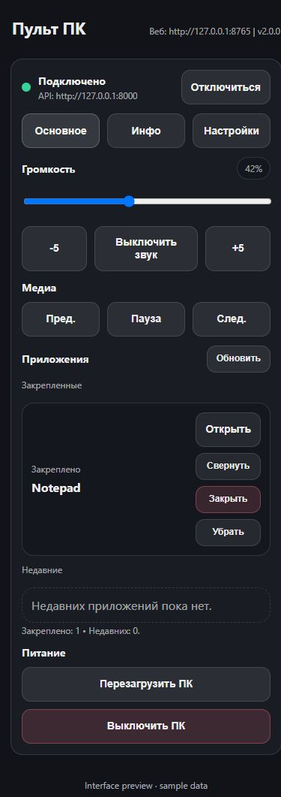
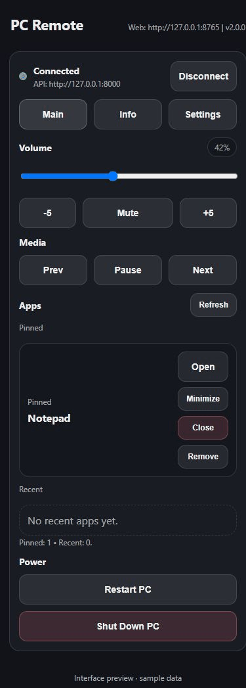

<p align="center">
  
</p>

<h1 align="center">PC Remote</h1>

<p align="center">
  <strong>Управляйте Windows-компьютером или Mac из браузера телефона.</strong><br>
  Без мобильного приложения, аккаунта и облака. Запустили, отсканировали QR-код — готово.
</p>

<p align="center">
  <a href="README.md">English</a> · <strong>Русский</strong>
</p>

<p align="center">
  <a href="https://github.com/mimaxon1/pc-remote/releases/latest"><strong>Скачать для Windows или macOS</strong></a>
  ·
  <a href="docs/faq_RU.md">FAQ</a>
</p>

<p align="center">
  <a href="https://github.com/mimaxon1/pc-remote/actions/workflows/tests.yml"></a>
  
  
  
</p>

PC Remote 2.0 — лёгкий open-source пульт для Windows и macOS, который превращает браузер Android или iPhone в локальную панель управления компьютером. Приложение на Rust спокойно работает в системном трее или строке меню macOS и не опрашивает систему в фоне, когда простаивает.

Подходит для дивана и ТВ, презентаций, демонстрационных ПК, стриминга, домашней сети и других сценариев в одном Wi-Fi/LAN.

## Как выглядит пульт

<p align="center"></p>

<details><summary>Посмотреть работу кнопок громкости</summary>



</details>

Настоящий интерфейс с тестовыми ответами; это не запись управления физическим компьютером.

[Сайт и инструкция](https://mimaxon1.github.io/pc-remote/ru/) · [Сравнение с Unified Remote](https://mimaxon1.github.io/pc-remote/ru/unified-remote-alternative/)

## Почему PC Remote

- **На телефон ничего ставить не нужно** — достаточно современного браузера.
- **Нет аккаунта и облака** — управление остаётся внутри локальной сети.
- **Быстрое подключение** — запуск приложения и QR-код.
- **Есть готовые сборки для компьютера** — обычному пользователю не нужны Python и приложение на телефоне.
- **Полезные повседневные функции** — приложения, окна, громкость, мультимедиа и доступные действия питания.
- **Открытый исходный код** — можно проверить, изменить или собрать проект самостоятельно.

Если вы ищете open-source пульт для Windows или Mac с управлением из браузера, PC Remote сделан именно для этого сценария.

В macOS медиакнопки управляют приложением Music. Для команд питания и окон macOS может запросить разрешение Automation; для окон может потребоваться включить PC Remote в **System Settings → Privacy & Security → Accessibility**. Если автозапуск в macOS 13 и новее требует подтверждения, приложение откроет **System Settings → General → Login Items**.

## Быстрый старт

1. Откройте [последний релиз](https://github.com/mimaxon1/pc-remote/releases/latest).
2. Скачайте установщик или portable-сборку для Windows либо universal-сборку для macOS.
3. Запустите `PC Remote`.
4. Нажмите **Show phone pairing QR code** в трее или строке меню.
5. Отсканируйте QR-код телефоном в той же локальной сети.
6. Управляйте компьютером из браузера.

Каждый релиз 2.0 по тегу собирает установщик и portable ZIP для Windows, universal-приложение для macOS в DMG и ZIP, а также SHA-256 checksums.

## Что можно управлять

- Системной громкостью и mute
- Мультимедиа
- Состоянием текущего аудиовыхода
- Недавними и закреплёнными приложениями
- Запуском desktop-приложений
- Открытием, сворачиванием и закрытием окон
- Выключением и перезапуском Windows и доступными действиями питания macOS
- Автозапуском и поведением приложения в трее
- Светлой и тёмной темой
- Русским и английским web-интерфейсом

## Где это удобно

- Диван / HTPC
- ПК, подключённый к телевизору
- Презентации и демонстрационные компьютеры
- Игровые и стриминговые сетапы
- Второй экран как панель управления
- Домашняя лаборатория и self-hosted-системы

## Local-first архитектура

```text
Браузер телефона
       |
       | локальный Wi-Fi / LAN
       v
Одно приложение Rust
       +-- web-контроллер :8080
       +-- API :8000
       |
       +-- аудио / мультимедиа
       +-- приложения и окна
       +-- управление питанием
       +-- аутентификация
       |
Трей Windows или строка меню macOS
```

Внешний аккаунт и облачный backend для работы не нужны.

## Безопасность

PC Remote рассчитан на доверенную локальную сеть. **Не публикуйте его порты напрямую в интернет.**

- PIN-коды хранятся как salted PBKDF2-HMAC-SHA256 хеши
- Сессионные токены создаются генератором случайных чисел ОС и хранятся в памяти
- CORS ограничен локальными origin-адресами
- Попытки входа ограничиваются rate limit
- Runtime-настройки хранятся в `%APPDATA%\PC Remote` на Windows и `~/Library/Application Support/PC Remote` на macOS

По умолчанию используется HTTP, потому что приложение предназначено для локальной сети. Для доступа извне используйте аутентифицированный VPN или другой защищённый транспорт вместо прямого проброса портов.

Сообщение об уязвимостях: [SECURITY.md](SECURITY.md).

## Сборки и релизы

Сборки для Windows:

- **Installer** — установка для текущего пользователя с ярлыком в меню «Пуск».
- **Portable ZIP** — распаковать и запустить без установки.

Для macOS собирается universal-приложение для Apple Silicon и Intel в DMG и ZIP. Пакет подписан только локальной подписью и пока не заверен Apple; при первом открытии система может запросить разрешение.

Релизы по тегам `v*` автоматически собирают обе платформы через GitHub Actions, запускают Rust-тесты, создают установщики и архивы и публикуют SHA-256 checksums.

## Запуск из исходников

Требования:

- Windows 10/11 или macOS 12+
- Rust stable
- Компьютер и телефон в одной локальной сети

```sh
cargo run
```

## Сборка из исходников

```sh
cargo build --release
```

Portable-результат:

```text
target\release\pc-remote.exe
```

Установщик Windows собирается из [`installer/PC-Remote.iss`](installer/PC-Remote.iss) через Inno Setup 6.

## Тесты

```powershell
cargo test --locked
```

Тесты также запускаются через GitHub Actions.

## Структура проекта

```text
.
|- src/                    Rust API, трей, авторизация и управление системой
|- web/                    web-интерфейс для телефона
|- Cargo.toml              зависимости и профиль сборки Rust
|- Cargo.lock              зафиксированные зависимости релиза
|- installer/              описание Windows-установщика
|- docs/                   документация и материалы для публикации
```

## Документация

- [FAQ и сценарии](docs/faq_RU.md) · [English](docs/faq.md)
- [Тестирование](docs/testing_RU.md) · [English](docs/testing.md)
- [Материалы для публикации](docs/PROMOTION.md)
- [История изменений](CHANGELOG_RU.md) · [English](CHANGELOG.md)
- [Contributing](CONTRIBUTING.md)

## Лицензия

Apache License 2.0. См. [LICENSE](LICENSE) и [NOTICE](NOTICE).
